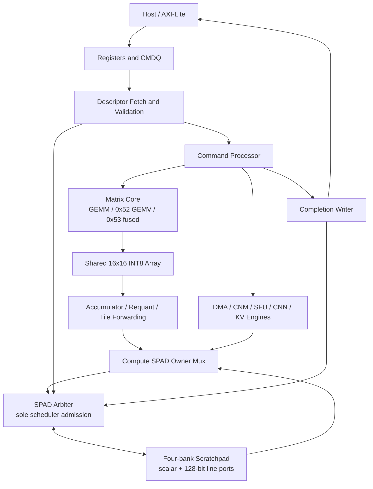

# NMAForge v2 Compute Cluster — Architecture Walkthrough

This guide follows one tensor command from software-visible descriptor to
scratchpad result. The design keeps one shared 16×16 INT8 array; the two v2
features change operand scheduling and result movement around that array.

## 1. Block-level path

The only chip integration top is [`ai_accel_top.v`](../../rtl/top/ai_accel_top.v).
The descriptor ABI and queue lifecycle are shared with legacy operations.
Descriptor fetch and completion writes use the control path; Matrix, DMA, and
other data-plane clients enter the scheduler-side SPAD arbiter. A command
finishes only after the completion writer has committed the completion words
and advanced the completion tail.

## 2. Software command to engine launch

1. Software writes descriptors and rings the CMDQ tail through the AXI-Lite
   register interface.
2. [`ai_command_processor.v`](../../rtl/control/queue/ai_command_processor.v)
   owns command lifecycle, fetch request, queue pointer movement, engine launch,
   and completion sequencing.
3. [`ai_accel_opcode_decode.v`](../../rtl/control/descriptor/ai_accel_opcode_decode.v)
   classifies `0x52` and `0x53` as tensor-matrix commands.
   [`ai_descriptor_validator.v`](../../rtl/control/descriptor/ai_descriptor_validator.v)
   checks opcode/version/dimensions and descriptor constraints before launch.
4. The selected engine returns `busy/done/error` and result metadata to the
   command processor. Completion is written through the completion path; host
   software observes CPLQ after the full commit.

## 3. Shared data path and ownership

[`ai_compute_spad_mux.v`](../../rtl/top/fabric/compute/ai_compute_spad_mux.v)
selects among seven single-word compute clients and retains the accepted owner
through the registered response. The mux presents one core client to
[`ai_spad_arbiter.v`](../../rtl/memory/ai_spad_arbiter.v), which is the single
scheduler-side SPAD admission point. It prioritizes descriptor/completion
traffic and arbitrates data-plane requests; response tags route results back
to their request owner.

[`ai_scratchpad.v`](../../rtl/memory/ai_scratchpad.v) implements four banks,
registered reads, scalar and 128-bit line access, banked Matrix access, and
CNM access. Its `BANKS` and `WORDS_PER_BANK` parameters describe logical
behavioral storage. RTL behavioral simulation does not establish physical
SRAM timing or macro area. The v2 capacity experiment changes the top-level
simulation parameter while keeping four banks, 128-bit lines, and the Matrix
array constant.

## 4. The one Matrix engine

[`ai_tensor_matrix_core.v`](../../rtl/compute/matrix/ai_tensor_matrix_core.v)
owns descriptor-driven address generation, requests and response waits,
transpose/bias handling, tile scheduling, bounded caches, prefetch, error
drain, requantization, and writeback. Its main controller states are:

| State group | Work |
|---|---|
| `IDLE` | Wait for a command and latch descriptor fields |
| `A_REQ/A_WAIT`, `B_REQ/B_WAIT`, `BIAS_REQ/BIAS_WAIT` | Request operands and wait for registered SPAD responses |
| `PREP_MAC`, `MAC` | Load an operand bank and update the active K slice |
| `WRITE`, `NEXT` | Format/write the output tile and advance the shape/tile iterator |
| `PREFETCH_WAIT` | Join or drain the bounded Next-K prefetch before using its data |
| `ERROR`, `ERROR_DRAIN`, `DONE` | Report errors, drain accepted traffic, or complete normally |

[`ai_tensor_matrix_array.sv`](../../rtl/compute/matrix/ai_tensor_matrix_array.sv)
contains two operand banks and 256 signed 8-bit multipliers feeding 64-bit
accumulators. It is output-stationary: the controller supplies K-slice data;
the array updates local accumulators and returns selected/requantized outputs.
The 16×16 compute resource is shared between regular GEMM and K-folded GEMV.

### Contribution 1 — shape-adaptive GEMM/GEMV

Opcode `0x52` maps a small-M vector operation onto the same array. K is folded
across physical lanes, with a partial reduction into output rows. The existing
bounded B-fold cache reuses an operand tile; the optional Next-K prefetch
fetches a subsequent slice while current work proceeds. Shape and the fixed
capacity bound determine whether reuse is permitted; long-K cases bypass the
bounded cache. The stable comparison control is the B-fold Cache OFF/ON ×
Prefetch OFF/ON matrix, with equal operands and descriptor shape.

## 5. Fused epilogue and tile forwarding

Opcode `0x53` reuses the Matrix accumulator/output path and applies the
existing signed requantization, saturation, and activation contract before
writing the result in the next Matrix-A tile layout. A small dual-bank elastic
forwarding store can capture a matching producer tile for a later consumer;
otherwise the legacy SPAD write/read path remains available. The handoff is
software ordered and tag/bank matched; it is not a coherent general-purpose
cache or unrestricted engine-to-engine network.

The result movement is controlled inside the Matrix core, not by adding an
independent compute engine. The `ENABLE_ELASTIC_TILE_FORWARDING` parameter
selects the optional path. Directed Top CMDQ checks compare the producer and
consumer output bytes and check that the legacy writeback remains enabled.

## 6. How to reproduce the bounded evidence

### Top smoke and key opcodes

From `dv/subsystem/top_smoke/sim`, run `make ai_smoke` with the VCS environment
configured. The fixed replay recorded for this baseline used VCS
`V-2023.12-SP1_Full64`, seed `20261106`, and passed normal completion, INT8
GEMM, `0x52`, and `0x53` smoke cases. Exact invocation and run ID are in the
[DV closure report](../verification/NMAFORGE_V2_DV_CLOSURE.md).

### Trained CNN

The reproducible model, test set, selected input, Golden bytes, and manifests
are checked in at
[`benchmark/models/nma_tiny_cnn_10class`](../../benchmark/models/nma_tiny_cnn_10class/).
Training is scripted by
[`train_nma_cnn_demo.py`](../../benchmark/tinynpu/train_nma_cnn_demo.py);
Top descriptor generation and full held-out replay are scripted by
[`generate_nma_cnn_workload.py`](../../benchmark/tinynpu/generate_nma_cnn_workload.py)
and [`run_nma_cnn_demo_dataset.py`](../../benchmark/tinynpu/run_nma_cnn_demo_dataset.py).
The fixed experiment has 396/396 exact Top Golden runs and 96.97% accuracy.
See the [model report](../benchmark/NMAFORGE_V2_MODEL_BENCHMARK.md) for exact
hashes, host/compute cycle separation, and the 128/512 KiB results.

### Benchmarks and limits

The fixed GEMM/GEMV shapes, array-cycle versus modeled-memory boundary,
Cache/Prefetch ablation, fused-model cycles, and capacity results are in the
[performance report](../benchmark/NMAFORGE_V2_PERFORMANCE_COMPARISON.md) and
its CSV/JSON records. The TinyNPU reference is
`8216c22b762011aa20c05fc2768423fd12dda59d`. It provides direct array cycles
for the cited comparison; an estimated common-memory endpoint must not be
reported as a TinyNPU controller measurement. The default checked-in
Transformer fixture uses hand-authored weights; the trained H=4 toy-task flow
can export weights for a Top replay, but this is not pretrained language-model
inference. Physical PPA and ASIC readiness are not established.

## 7. Round 8 performance reading example

The new Top profiler runs the trained H=4 toy Transformer through the same
production CMDQ and separates Prefill from one-token Decode. The output is in
[`Round 8 phase profile`](../../benchmark/v2_round8_transformer_phase_profile_20261107.csv)
and the 86 completion intervals are in the
[`per-command profile`](../../benchmark/v2_round8_transformer_command_profile_20261107.csv).
The Decode interval is 5,715 cycles: 4,537 SFU-busy, 958 no-engine
control/dispatch remainder, and 32 Matrix MAC-active cycles, with the
remaining exclusive Matrix/KV categories closing the count. This shows why
changing GEMM to GEMV at M=1 is unlikely to move this workload without
reducing SFU or command/packing costs. It does not report PE-lane utilization.

To reproduce the profile, use the `ai_transformer_trained` command in the
[Round 8 decision report](../benchmark/NMAFORGE_V2_ARCHITECTURE_UPGRADE_DECISION.md).
The larger CNN, higher-dimensional two-head Transformer, and a Matrix-GEMM
DMA-overlap Golden remain open; the failed exploratory Matrix overlap is not
counted as a passing architectural result.
