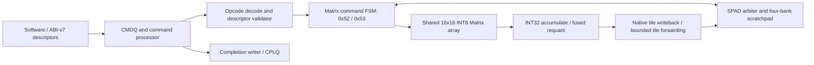

# NMAForge v2 TinyNPU Baseline Summary

## Research-ready finalization snapshot — 2026-11-06

**Final status: `RESEARCH_BASELINE_PARTIAL`.** This snapshot supersedes the
older model/capacity status below. Product RTL remains fixed at
`cd0a05d8ecd8cfb6c3f39b559788a2531e324b23`; protected R250 `main` remains
`3041355528dffe856e2d5384027c6ee5df5d1b42`.

- The fixed TinyNPU GEMM/GEMV matrix remains bound to NMAForge source/test
  `219c9f26a85b9661185cd78ab6308ae3f13e3ea7`, TinyNPU
  `8216c22b762011aa20c05fc2768423fd12dda59d`, and seed `20261106`: 3/3 GEMM
  and 4/4 GEMV independent Golden checks pass. The TinyNPU cycles are direct
  array timing; the common-memory endpoint is estimated. NMAForge uses 1.06–
  1.15× that estimate on the listed GEMMs, 0.54×/0.90× on the first two GEMVs,
  and 1.29×/1.44× on the larger two. These ratios are not a full-system
  performance win.
- A trained 10-class INT8 CNN now runs all 396 held-out images through Top
  CMDQ. All intermediate outputs match independent integer Golden; 384/396
  classify correctly (96.97%). The exact model, test set, one-image input,
  Golden bytes, manifests, and per-image CSVs are checked in.
- `conv1x_mini.onnx` passes NMAForge Top Golden at 128 KiB and 512 KiB. The
  TinyNPU compiler Golden bytes match, but TinyNPU graph-runtime cycles were
  not rerun in this capacity study, so no current paired CNN speedup is
  claimed.
- The two CNN workloads and the compact-map trained Digits MLP produce the
  same outputs and cycles at 128 KiB and 512 KiB behavioral SPAD. These are
  tested placement candidates for those workloads only. The 86-descriptor
  Transformer fixture has a scoped 128 KiB replay (301 checks pass), while
  the enclosing full smoke fails 23 unrelated checks. 64/256 KiB remain
  untested.
- The Transformer result still uses hand-authored fixed fixture weights:
  5,682 prefill cycles and 5,715 cycles for one decode token. Trained-weight
  Transformer inference and TinyNPU comparison are incomplete. DC/physical
  PPA remains `NOT_RUN` / `BLOCKED_ENV`; v2 DV sign-off remains open.

Unified fixed-run table:
[`CSV`](../../benchmark/v2_research_benchmark_matrix_20261106.csv) /
[`JSON`](../../benchmark/v2_research_benchmark_matrix_20261106.json).
Rebuild with `python3 benchmark/tinynpu/build_v2_research_benchmark_matrix.py`.
Capacity and model evidence:
[`capacity CSV`](../../benchmark/v2_spad_capacity_study_20261106.csv),
[`capacity JSON`](../../benchmark/v2_spad_capacity_study_20261106.json),
and [`trained model artifacts`](../../benchmark/models/nma_tiny_cnn_10class/).
The execution frontier records the frozen scope and open items; final commit
and publication identity are included in the delivery handoff.

**Status:** Fixed benchmark matrix complete; full DV remains paused/HOLD; no
ASIC sign-off claim. **Date:** 2026-11-06.

## Baseline and implementation

- NMAForge branch: `feature/npu-architecture-v2`; measured source SHA
  `219c9f26a85b9661185cd78ab6308ae3f13e3ea7` (tree at audit
  `e2e3f1d1cc7dfa4de3e3d78fd51fab76d6c43f24`).
- Product RTL SHA: `cd0a05d8ecd8cfb6c3f39b559788a2531e324b23`.
- Protected baseline: `main` R250
  `3041355528dffe856e2d5384027c6ee5df5d1b42`.
- GitHub v2 branch head at fetch:
  `5d01a88a8a2a7b1add15fbedbb02096d686824ab`; local branch was 77 commits
  ahead and 0 behind (remote tree `bf7306bdeefeca415dd221f0a29305fdcef5b72c`).
  The current task preserves the pre-existing uncommitted
  UVM fairness edit and all other worktrees.
- TinyNPU reference SHA:
  `8216c22b762011aa20c05fc2768423fd12dda59d`.

The product path reuses one 16×16 / 256-INT8-MAC Matrix array. Innovation 1
is Shape-Adaptive GEMM/GEMV (`0x52`) with bounded B-fold reuse and Next-K
prefetch. Innovation 2 is fused requantization/native tile writeback (`0x53`)
with bounded elastic Tile Forwarding. The preceding TinyNPU benchmark
snapshot changed only its driver/marker checks and reports/data; the current
research closure round adds only compact workload/testbench plumbing and
reports. No product RTL was changed.

## Minimum functional evidence

| Function | Evidence | Result |
|---|---|---|
| Normal Top command/completion | Clean Top smoke, test SHA `839b9af5bcd2ab5f85c52f0d014d8f46e794c1a0` | PASS for the archived smoke scope; not full DV closure |
| INT8 GEMM | Current matched 3-shape matrix, Run ID `V2-TINY-GEMM-MATCH-S20261106`, seed `20261106` | 3/3 NMAForge Goldens PASS |
| Opcode `0x52` GEMV | Current matched 4-shape matrix, Run ID `V2-TINY-GEMV-MATCH-S20261106`, seed `20261106` | 4/4 NMAForge Goldens PASS |
| Opcode `0x53` / trained Digits MLP | `V2-DIGITS-0x53-360`, source SHA `33e85287fbf37187fccb76e97be6effe888670e9` | 360/360 exact Golden logits; 352/360 classification (97.78%); 34,761 CMDQ cycles |
| ONNX mini CNN | `V2-CNN-4B99D10-S20261029`, source replay `d1867da` | All checked intermediate tensors and 4/4 outputs PASS |

These scoped records establish core function only. Full v2 requirement closure,
coverage, mutation and formal closure are not being pursued in this round.

## TinyNPU comparison

TinyNPU array cycles are measured from its pinned Verilated RTL. TinyNPU has no
memory controller/SPAD in this experiment. Its separate common endpoint uses a
single serialized 16-byte/cycle port, logical INT8 operand bytes, INT32 output
bytes, one read-response cycle, and two initial accumulator-clear cycles.
That endpoint is **estimated, not RTL measured**. Ratios below are
NMAForge-measured cycles divided by this TinyNPU estimate.

| GEMM M×N×K | NMA cycles | Tiny array | Tiny memory estimate | NMA / estimate | NMA utilization |
|---|---:|---:|---:|---:|---:|
| 16×16×16 | 173 | 52 | 151 | 1.1457 | 9.25% |
| 16×16×32 | 259 | 100 | 231 | 1.1212 | 12.36% |
| 32×32×64 | 1,380 | 790 | 1,305 | 1.0575 | 18.55% |

| GEMV M×N×K | NMA cycles | Tiny padded-array cycles | Tiny memory estimate | NMA / estimate | NMA utilization |
|---|---:|---:|---:|---:|---:|
| 1×13×17 | 66 | 100 | 122 | 0.5410 | 1.31% |
| 8×16×19 | 148 | 100 | 164 | 0.9024 | 6.42% |
| 16×16×19 | 264 | 100 | 205 | 1.2878 | 7.20% |
| 16×16×65 | 634 | 244 | 441 | 1.4376 | 10.25% |

Both sides pass all outputs against the same deterministic INT8 operands and
independent INT32 Golden. Tiny GEMV rows are padded direct-array mappings,
not a native TinyNPU GEMV engine. Therefore the ratios do not establish a
system-level performance win. Full bytes, stall observations and run identity
are in the [GEMM](../../benchmark/v2_tinynpu_gemm_current_20261106.csv) and
[GEMV](../../benchmark/v2_tinynpu_gemv_current_20261106.csv) CSVs and matching
JSON files.

## Innovation ablations and bottlenecks

- B-fold Cache reduced cycles 22.3–41.6% and read traffic 35.2–56.5% over
  Cache OFF / Prefetch OFF in the fixed 48-point GEMV ablation. Prefetch with
  Cache ON helps M8 by about 2%, but regresses the measured M16 cases by
  0.6–0.8%.
- Fused Digits reduced the matched doorbell-to-completion window from 110,155
  to 34,761 cycles (68.44%) with byte-identical RTL logits. The R250 and v2
  layout counters have different event semantics and are not compared as
  traffic ratios.
- Tile Forwarding saved 23 cycles (about 8%) and halved source-A bank reads
  in the three-seed Matrix-core directed comparison. It is not a full Top
  CMDQ producer/consumer result.
- Large GEMM remains limited by data service: at 32×32×64 NMA utilization is
  18.55%, with 134 bank-stall, 77 line-stall, 211 arbiter-stall and 77
  writeback-wait observations. These counters overlap. Small-M GEMV remains
  underutilized; M=1 reaches 1.31% array utilization.
- The paired mini CNN is correct on both systems, but NMA's 1,985 compute +
  1,080 host-layout cycles and TinyNPU's 4,781 graph cycles use different
  timing endpoints, so there is no valid CNN speedup ratio.

Plots and raw ablation data: [three-seed Cache×Prefetch GEMV plot](../../benchmark/v2_gemv_four_way_clean_839b9af_3seed.svg),
[three-seed Matrix configuration plot](../../benchmark/v2_matrix_config_closure_f9f32f7_3seed.svg),
and [Digits legacy/fused model comparison CSV](../../benchmark/v2_digits_model_comparison.csv).

## Scratchpad capacity assessment

Current organization is four banks of 32-bit words. Counts below are logical
storage only; `relative capacity` is not an actual macro count or area result.

| Total SPAD | Words/bank | Storage bits | Relative capacity |
|---:|---:|---:|---:|
| 512 KiB | 32,768 | 4,194,304 | 1× |
| 256 KiB | 16,384 | 2,097,152 | 1/2× |
| 128 KiB | 8,192 | 1,048,576 | 1/4× |
| 64 KiB | 4,096 | 524,288 | 1/8× |

Digits' legacy map reaches 351,232 bytes from SPAD base, but a compact static
map now runs the 360-sample model at both 128 KiB and 512 KiB with 93,184-byte
high-water and identical cycles/Golden. The mini-CNN address map reaches
135,296 bytes in its older placement; compact 128 KiB CNN runs are separately
recorded in the capacity report. No >128 KiB streamed workload or added DMA
traffic measurement was completed; the 5% performance-loss goal is not
established for streaming or arbitrary models. See the [capacity CSV](../../benchmark/v2_spad_capacity_study_20261106.csv)
and [round-2 MLP CSV](../../benchmark/v2_round2_capacity_mlp_20261106.csv).

The capacity result is currently limited to source/address arithmetic because
the default `python3` is 3.6.8 and cannot run the mapper's type syntax, while
Python 3.12.13 in this environment has no NumPy dependency. No packages or
system setup were changed to force a reduced-SPAD run.

Relevant fixed addresses (offsets from the SPAD base, in bytes):

| Workload | Weights / inputs | Hidden or intermediate | Output | CMDQ descriptors | CPLQ |
|---|---|---|---|---|---|
| Digits MLP | W1 `0x10000`, B1 `0x12000`, W2 `0x13000`, B2 `0x13400`, input `0x50000` | hidden `0x32000` | logits `0x3B000` | `0x38000`, 46 × 64 B | `0x3A000`, 46 × 16 B |
| Digits MLP compact profile | W1 `0x1000`, B1 `0x2000`, W2 `0x2100`, B2 `0x2500`, input `0x11000` | hidden `0x3000` | logits `0xB000` | `0x9000`, 46 × 64 B | `0xA000`, 46 × 16 B |
| `conv1x_mini` | im2col `0x10000`, conv weights `0x11000`, FC weights `0x19000` | intermediates `0x12000`–`0x1D000` | final `0x1E000` | `0x20000`, 8 × 64 B | `0x21000`, 8 × 16 B |

## Run identity and open status

- Run IDs: `V2-TINY-GEMM-MATCH-S20261106`,
  `V2-TINY-GEMV-MATCH-S20261106`; seed `20261106`.
- Tools: VCS `V-2023.12-SP1_Full64`; TinyNPU RTL model built with Verilator
  `5.052`; g++ `8.5.0`; Python `3.12.13` for artifact generation.
- NMA raw log archive:
  `/tmp/nmaforge_v2_tinynpu_evidence_20261106.tar.gz`, SHA-256
  `3cf83dea684002740ead224ac1fec60e4710c44b2fa887c718082699b51debb9`.
- Published to GitHub `feature/npu-architecture-v2` through the connected GitHub
  App as fast-forward snapshot commit `9a61b4852b61e830c2e284c3b980242a76410148`,
  parent `5d01a88a8a2a7b1add15fbedbb02096d686824ab`, tree
  `c78b01dd28074512cdb56304a4c629cd47fb03f8` (matching local tree at
  `3d4b97666af79d01329b1307fe3560f0e7db5fea`). Standard Git transport lacked
  authentication. Remote history and `main` were preserved; the separate
  uncommitted UVM worktree edit was excluded.
- Full v2 DV sign-off: **PAUSED / PARTIAL**. TinyNPU memory RTL and matched
  system endpoint: **NOT_RUN**. Reduced-SPAD mapping/timing: **NOT_RUN**.
  Current v2 PPA: **BLOCKED_ENV** (private libraries/SDC/macros absent). No
  testchip or ASIC readiness claim is made.

The fixed matrix, static capacity table and reports complete the current
bounded task. No further phase is started by this report.

## Research Closure Round 2 — final addendum (2026-11-06)

The bounded round added only compact Digits MLP address-profile plumbing and
reports. Product RTL is unchanged at
`cd0a05d8ecd8cfb6c3f39b559788a2531e324b23`. Code commit:
`acfaec281f5414c0e357c1dc7985b79a829c8c30`; report/evidence commit follows.

### Results

- **Digits MLP capacity:** the same trained 360-sample INT8 model passes at
  128 and 512 KiB. Both runs are 34,761 doorbell-to-CPLQ cycles, 352/360
  correct (97.78%), 46 descriptors, 1,884,160 MACs, 54.2033 MAC/cycle, and
  21.17% derived utilization. Compact-map high-water is 93,184 B; outputs are
  byte-identical to the independent integer Golden. This is static placement,
  not streaming.
- **Transformer:** the existing fixed 86-descriptor fixture at 128 KiB
  passes 301 fixture Golden/KV checks, with 5,682 prefill and 5,715 one-token
  decode cycles (11,397 total). The enclosing full smoke fails 23 unrelated
  checks. The fixture maps Q/K/V projections, KV reads/writes, QK transpose,
  causal softmax, attention-value/output projections, residuals, layer norm,
  FFN/GELU, and decode KV update for hidden=4, one head, four prefill tokens.
  No trained checkpoint/export or external weight-loading path was found;
  deterministic fixture weights are not trained-model evidence.
- **CNN layout:** the mini-CNN's 1,080 Host Layout cycles equal 36 groups ×
  (one AXI-Lite read + four writes) × six cycles. `0x53` native Matrix-A
  layout cannot directly supply the current flattened K=144 consumer tensor;
  no fused CNN speedup is claimed.
- **TinyNPU:** retain reference SHA
  `8216c22b762011aa20c05fc2768423fd12dda59d`. Existing 3 GEMM + 4 GEMV
  numbers remain direct-array measurements on TinyNPU versus NMAForge RTL
  controller cycles and a separately estimated memory endpoint. Mini-CNN
  NMAForge compute+host-layout cycles and TinyNPU graph cycles have different
  boundaries, so no system speedup ratio is reported.
- **Capacity/streaming:** checked-in tested live sets are below 128 KiB
  (MLP 93,184 B; Transformer fixture 79,200 B including queue tables; CNN
  below 70 KiB). No greater-than-128-KiB workload or streamed DMA run was
  available. Theoretical 4K×32 macro counts for 512 / 256 / 128 / 64 KiB are
  32 / 16 / 8 / 4; actual PPA is unavailable.

### Reproduction and final disposition

Exact Run IDs, command lines, tool versions, source SHA, result/log hashes,
TinyNPU table references and open issues are in
[`round-2 JSON`](../../benchmark/v2_round2_research_closure_20261106.json)
and [`capacity CSV`](../../benchmark/v2_round2_capacity_mlp_20261106.csv).
VCS is `V-2023.12-SP1_Full64`; Python is `3.12.13` (NumPy `2.4.6`). Product
RTL did not change. The package is **RESEARCH_BASELINE_PARTIAL**: trained
Transformer, >128 KiB streaming, same-boundary CNN/TinyNPU model timing, and
ASIC PPA are not complete. This is the final stop for this round; no follow-on
task is started automatically.

## Paper-style framing (evidence-limited)

**Abstract.** NMAForge is a four-bank compute-near-memory accelerator prototype
with one shared 16×16 INT8 Matrix array. We evaluate two additive datapath
features on this fixed resource budget: shape-adaptive GEMM/GEMV execution with
bounded operand reuse and prefetch, and fused INT8 epilogue output with a
bounded inter-layer tile-forwarding buffer. Fixed-shape RTL ablations show
reduced operand traffic from B-fold caching, while a trained Digits MLP
comparison shows exact output agreement and a shorter doorbell-to-completion
interval for the fused path. A compact static map lets that MLP run at 128 KiB
behavioral SPAD with no measured cycle change versus 512 KiB. TinyNPU comparisons
are limited to fixed GEMM/GEMV array timing plus a modeled memory endpoint;
they do not establish a system-level performance advantage. Trained Transformer
inference, >128 KiB streaming, physical SRAM cost, and ASIC PPA remain open.

| Candidate contribution | RTL mechanism | Current evidence | What remains unproven |
|---|---|---|---|
| Shape-adaptive execution with bounded operand reuse | `0x52` shares `ai_tensor_matrix_core` / `ai_tensor_matrix_array`; K-fold schedule uses bounded cache and optional prefetch | Fixed-shape multi-seed Cache×Prefetch ablation; 48 Golden points, reduced read traffic | Model-level GEMV benefit, large-shape scheduling, matched TinyNPU system endpoint |
| Fused epilogue and inter-layer tile forwarding | `0x53` requantizes to signed INT8 native Matrix-A layout; 512 B two-bank tagged forwarding storage | Trained Digits MLP exact logits, 110,155→34,761 CMDQ cycles; directed forwarding Core ablation | CNN flatten-layout elimination, full producer/consumer Top concurrency, SRAM/PPA cost |

## RTL walkthrough for study

| Learning step | RTL / document | What to follow |
|---|---|---|
| Integration and interfaces | `rtl/top/ai_accel_top.v`; [system architecture](../architecture/ARCHITECTURE.md) | AXI-Lite control, AXI4 DMA, CMDQ/CPLQ, engine and SPAD connections |
| Descriptor/lifecycle | `rtl/control/queue/ai_command_processor.v`, `rtl/control/queue/ai_parallel_compute_dispatcher.v`, `rtl/control/descriptor/ai_descriptor_validator.v` | Command ownership, dispatch, ABI-v7 legality and completion lifecycle |
| Matrix datapath and innovations | `rtl/compute/matrix/ai_tensor_matrix_core.v`, `ai_tensor_matrix_array.sv`, `ai_tensor_matrix_datapath.v`; [v2 contract](../spec/NPU_ARCHITECTURE_V2_SPEC.md) | Core FSM (`ST_A_REQ` through `ST_DONE`/drain), 0x52 K-fold/prefetch, 0x53 epilogue/forwarding, shared array datapath |
| Scratchpad ownership | `rtl/memory/ai_spad_arbiter.v`, `rtl/top/fabric/memory/ai_accel_memory_fabric.v`, `rtl/top/fabric/memory/ai_accel_spad_subsystem.v`, `rtl/memory/ai_scratchpad.v` | Sole scheduler admission point, registered read return, four-bank behavioral memory |
| Completion | `rtl/control/queue/ai_completion_writer.v` | Four-word completion commit before CPLQ tail advancement |
| Reproduction | `dv/subsystem/top_smoke/tb/tb_ai_accel_smoke.sv`, `dv/subsystem/top_smoke/sim/Makefile`; product GEMV suite under `dv/block/compute/matrix/sim` | Top CMDQ/CPLQ model runs and focused Cache×Prefetch ablation entry points |

The candidate title is **A Memory-Efficient Compute-Near-Memory NPU with
Shape-Adaptive Execution and Fused Inter-Layer Dataflow for Edge AI**. These
are research hypotheses supported by bounded RTL experiments, not claims of
novelty, product-level TinyNPU superiority, trained Transformer operation,
ASIC PPA, or tapeout readiness.
