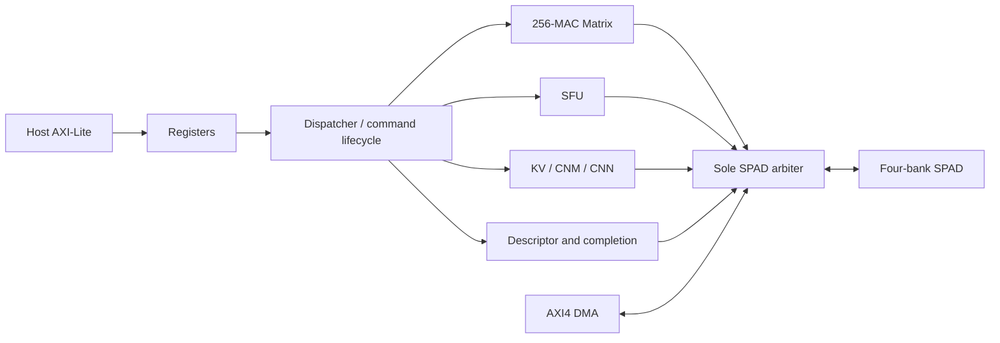

# Stage A architecture baseline and candidate boundary

Status: **DESIGN_PARTIAL — Stage A complete; architecture review required before B/C.**
Reviewed product branch `nmaforge`, HEAD `da5a6691c7582d54c7a2da643e01d296f8da2d68`;
latest scheduling RTL commit `b2b3b0b5942f9218ed574a04e946104109dc2c99`.
The product `rtl/` tree is unchanged in this delivery, Git tree
`479f24f33af0ccfa87fd7458ac9c43f94aae7398`. The publishing commit identifies the
observation/scripts/reports separately. This is a baseline specification, not a
claim that proposed hardware exists.

Machine-readable source, model, fixture and result pins:
[manifest.json](../../benchmark/research/stage_a/manifest.json).
Normative contracts remain [SPEC_ZH](../spec/SPEC_ZH.md),
[Compute Cluster SPEC](../spec/COMPUTE_CLUSTER_SPEC_ZH.md),
[SFU numeric contract](../spec/SFU_NUMERIC_CONTRACT_ZH.md), and
[architecture](../architecture/ARCHITECTURE.md). Source lists are unchanged.

## Implemented modules and interfaces

| Block / source under `rtl/` | Input / output and ownership |
|---|---|
| `top/ai_accel_top.v` | Sole IP top; single `aclk`, active-low reset, IRQ, 32-bit AXI-Lite and 128-bit AXI4 master |
| `control/axi_lite/axi_lite_reg_if.v`, register block | Independent AW/W capture; software configuration and sticky status, no queue-pointer ownership |
| Parallel dispatcher / command processor | Ordinary CMDQ parallel slots and ordered retirement / serial direct and macro compatibility; software must express dependencies |
| Descriptor fetch / validator / completion writer | 16-word descriptor, field validation, four-word completion committed before publishing tail |
| `top/fabric/compute/ai_compute_spad_mux.v`, `ai_spad_arbiter.v` | Per-engine scalar ownership to the sole scheduler admission point; descriptor/completion priority, data round robin |
| `memory/ai_scratchpad.v` | Four 32-bit banks; 8,192 words/bank = 128 KiB product default; 32,768 = 512 KiB compatibility; registered reads |
| `dma/ai_axi128_dma.v` | 128-bit AXI4, 64-bit addresses, 4-bit IDs; burst/backpressure/abort drain; shares scheduler SPAD bandwidth |
| `compute/matrix/ai_tensor_matrix_core.v`, `ai_tensor_matrix_array.sv` | One 16×16 output-stationary INT8 array; start/abort, latched descriptor operands, ordered bank responses, scalar/128-bit line writeback |
| `compute/sfu/ai_tensor_sfu_core.v`, `ai_tensor_sfu_math.v` | Word-addressed INT32/Q8.8/Q15 operands, scalar registered responses; shared iterative arithmetic; materialized output |
| CNM / CNN / KV engines | Bank-local CNM and convolution compatibility paths; KV descriptors copy/pack persistent ring data through shared fabric |

Module names/ports are checked against the above product sources and current
`dv/subsystem/top_smoke/sim/ai_accel.f`; the existing detailed
[Round 29 module list](../design/round29/MODULE_INTERFACE_LIST.md) supplies the
remaining hierarchy. No independent production GEMV engine is introduced.

## ABI, data and lifetime

ABI v7.4 is retained. Descriptor words 0..15 contain task/opcode, src0, src1,
bias, dst, M/N, extent, flags, aux0, postprocess, three strides, batch/head,
events, ABI/clear. Exact packed bits and opcode-specific restrictions remain in
the normative SPEC and software header. No new flag or opcode is allocated here.
Software publishes CMDQ_TAIL, consumes CPLQ_HEAD; hardware owns CMDQ_HEAD and
CPLQ_TAIL. Dependency events/draining must separate producer and consumer; a
matching address alone does not establish a dependency.

| Opcode / path | Layout and limits relevant to this review |
|---|---|
| `0x30/0x31` Matrix | Legacy 4×4 tile-major operands; INT8 products, wide accumulation, specified bias/shift/clamp, materialized INT32 outputs |
| `0x52` shape-adaptive GEMV | Existing dense padded A/B contract; M/N≤16, bounded K/field restrictions; unsupported stride/transpose/batch/alias/range combinations rejected by validator |
| `0x53` fused GEMM→requant | Existing postprocess order, optional row-major output and explicitly opted-in bounded forwarding; not a silent replacement for INT32 legacy mode |
| `0x32/0x39`, `0x33/0x38` | Softmax/causal Softmax and RMSNorm/LayerNorm; deterministic integer contract, not floating-point library equivalence |
| `0x34/0x35/0x36/0x37` | Residual, piecewise GELU, INT8 requant, SiLU; retain rounding/saturation/packing |
| KV read/write | Existing head/token stride and ring policy; persistence checked across eight queue re-arms |

Scratchpad host/debug A and scheduler B are real shared ports per bank, not a
free port for each engine. Scalar admissions transfer 4 B, line/banked admissions
16 B; these are peak interface widths, not additive guaranteed bandwidth.
SPAD read data has two registered cycles in `ai_scratchpad`; sampled SFU reads
consume one request plus two wait clocks in this workload. Matrix preserves
ordered metadata, up to four outstanding reads; no response ready/ID allows
arbitrary reordering. CNM/Matrix responses retain distinct owners. Admission
stalls do not establish physical bank conflicts.

Matrix defaults: `MAX_OUTSTANDING_READS=4` and all four cache/prefetch/elastic
switches enabled. Existing A tile cache, next-K ping-pong prefetch, GEMV B cache
and fixed elastic cache remain. Elastic data state is two banks of 16×128 bits
=512 B. Current exact length-16 LN cache is 16×32 bits=64 B and command-local;
it removes X rereads for variance and affine, not Gamma/Beta reads. Length-16
Gamma multiplication already overlaps Beta fetch. Latency remains shape,
backpressure and opcode dependent; no single fixed engine latency is promised.

Reset flushes active ownership/validity. Abort/fault stops new work and drains
accepted reads before terminal state. Already accepted output writes form a
visible prefix; they are not rolled back. Completion ordering and error codes
are preserved. Proposed forwarding must inherit these semantics, invalidate
partial captures, and fall back on a miss. The current SFU has no cross-engine
cache or ephemeral tensor mode.

## Executable workloads and quality boundary

The CNN maps a trained digits model through host resize/coordinate planes and
Im2col into two GEMMs. Useful MAC definition includes the bias plane:
`196*(36*63+1+64*10)=570164`; padded array work is
`208*(36*64+64*16)=692224`. Golden checks 20,800 words; output readback is
832 words. Full held-out accuracy 96.1111%/360 examples is existing model metadata,
not a new full RTL dataset replay; current sample 42 predicts the correct class.

H16 is a trained synthetic-task **Post-LN** decoder: H=16, two heads of eight,
one layer, FFN width16, vocabulary32, ring context8, deterministic GELU16 INT8
weights. Eight teacher-forced decode stages each check 1,360 Golden words,
logits and physical KV. Four-token “prefill” populates QKV/KV only; full
Transformer prefill is not measured. Host-generated embeddings are preloaded;
no live host autoregressive token-feedback latency is measured. Raw legacy
persistent-session metadata says no host embedding; this is contradicted by
`generate_h16_incremental_decode.py` calling `embedding_input` and is explicitly
corrected here and in the manifest. Other Transformer intermediate arithmetic
executes in RTL.

Independent 1,024 held-out sequences / 4,096 predictions: INT8 accuracy
74.462890625%, CE 0.787709424 nats, perplexity 2.198355155. Original historical
FP32 reference was 82.1289% (7.666 percentage points higher); post-QAT FP32
checkpoint 62.8174% is a different baseline. Preserve this quality gap in research
claims. There is no pretrained GPT-2/Qwen weight compatibility demonstration.

## Bounded larger candidate budget

[Exact allocation table](../../benchmark/research/stage_a/analysis/larger_model_budget.json)
accounts for each 16-byte-aligned region, all resident weights/KV, padded four-row
INT32 and packed tensors, CMDQ128×64 B, CPLQ128×16 B, 4 KiB guard/metadata.
Hypothetical models have two heads, FFN=4H, vocabulary32 and bias-free linears.
Temporaries may be reused only after token/layer completion and after their
required observation lifetime. This is exact arithmetic for that specified
allocation policy, not a proof of a runnable mapper or actual compiler high water.

| Candidate | Bytes | 128 KiB margin | Execution |
|---|---:|---:|---|
| H32, L2, C16, FFN128 | 60,800 | 70,272 | Not trained/mapped/run |
| H64, L2, C16, FFN256 | 154,624 | −23,552 | Does not fit resident policy |
| H64, L2, C32, FFN256 | 165,120 | −34,048 | Does not fit resident policy |

Current H16 FFN16 allocator retains all eight stages: 49,920 logical tensor
bytes, tensor high water69,568, descriptor base69,632, completion base86,016,
reserved end88,064. Do not confuse this with the hypothetical H16 FFN64
26,688-byte reused budget. Generator/reference currently hardcode H16/one-layer/
context8 and KV8×8. H32 requires trained weights, generalized mapping, reference
and RTL Golden before use. H64 needs a separately reviewed streaming or 512 KiB
mode; capacity alone never establishes kernel support. No larger model was
silently substituted into the current benchmark.
