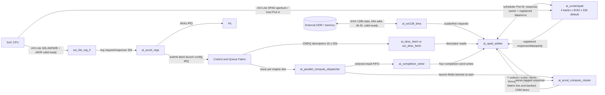
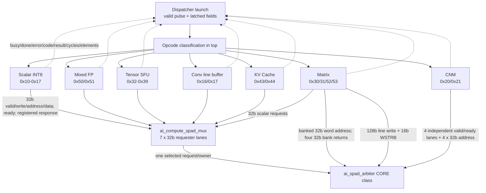
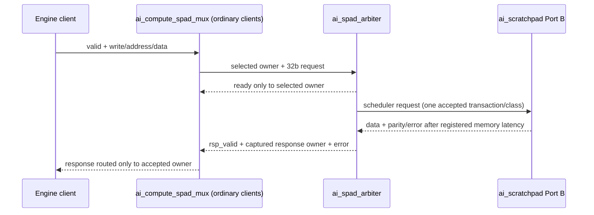
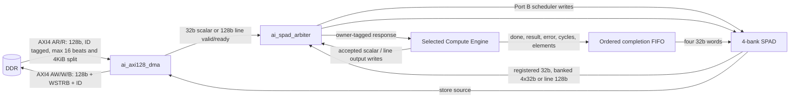
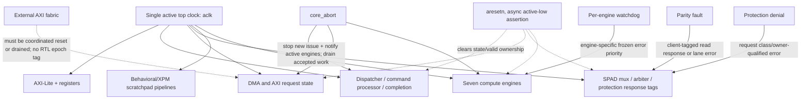

# Compute Cluster and Top Block Diagrams

**RTL baseline:** `fc60f95d72c0cfb7dfa9df895a30a701c842d21e`. These diagrams show modules instantiated in that RTL only. Signals and widths are taken from top and submodule ports; they do not add the planned macro wrapper or an unimplemented fabric epoch.

## 1. Full NPU Top Architecture



RTL basis: `rtl/top/ai_accel_top.v:24`, `:595`, `:628`, `:663`, `:1131`, `:1194`, `:1266`, `:1406`; AXI widths at module ports `:37..152`.

## 2. Compute Cluster Microarchitecture



The compute wrapper exports seven independent status vectors, with 7 busy/done/error bits, 28 error-code bits and 224 bits each for result/cycles/elements (`rtl/top/fabric/compute/ai_accel_compute_cluster.v:133..141`, `:184..204`). The aggregate `core_done` view is a serial compatibility signal and does not preserve multiple simultaneous completion identities (`:166..182`).

## 3. Shared SPAD Request/Response Dataflow



Banked side paths are separate interfaces but share admission: Matrix banked-read uses tag 3, CNM uses tag 5 and a registered per-lane response mask. They alternate in the same banked RR class. Line responses are distinguished by `rsp_is_line`. There is no response-ready or arbitrary response ID at these interfaces (`rtl/memory/ai_spad_arbiter.v:47..65`, `:143..177`).

## 4. Command Dispatch and Completion Lifecycle

```mermaid
sequenceDiagram
  participant SW as Software
  participant D as ai_parallel_compute_dispatcher
  participant F as Descriptor fetch + validator
  participant E as One of seven engines
  participant W as ai_completion_writer
  participant S as ai_spad_arbiter / SPAD
  SW->>D: publish CMDQ_TAIL / submit
  D->>F: fetch CMDQ_HEAD descriptor
  F-->>D: descriptor fields / fetch error
  D->>D: validate, wait dependency, reserve one engine slot and FIFO record
  D->>E: one-cycle launch_valid; engine latches fields
  E-->>D: independent done/error/result/cycle/elements
  D->>D: capture by engine slot; retire only FIFO head
  D->>W: task/status/error/result/elements
  W->>S: four 32-bit completion words, each valid/ready
  W-->>D: done after all four accepted
  D->>SW: advance CPLQ_TAIL; emit ordered event / dependency signal
  SW->>D: may advance CPLQ_HEAD while engines remain active (SPEC v1.8)
```

The result FIFO has eight slots; dispatch is one active slot per engine and completion retires in CMDQ order even if engines finish out of order (`rtl/control/queue/ai_parallel_compute_dispatcher.v:134..146`, `:395..428`). Completion storage is four words; tail advancement belongs to the dispatcher after writer done.

## 5. DMA → SPAD → Compute → Output Dataflow



This is a shared scheduler port. Compute and DMA can overlap in execution but their SPAD requests contend at admission. Software must prevent concurrent read/write address hazards across descriptors (REQ-PC-008). Accepted writes form an irreversible visible prefix; DMA store completion and compute completion are distinct transactions.

## 6. Clock / Reset / Abort / Fault Domains



The active top is single-clock; standalone dual-clock command shell modules do not become active domains in this top. Reset is not a memory clear. External AXI responses must not cross a reset boundary into new accelerator work; that guarantee is an integration contract and needs a real fabric test.
